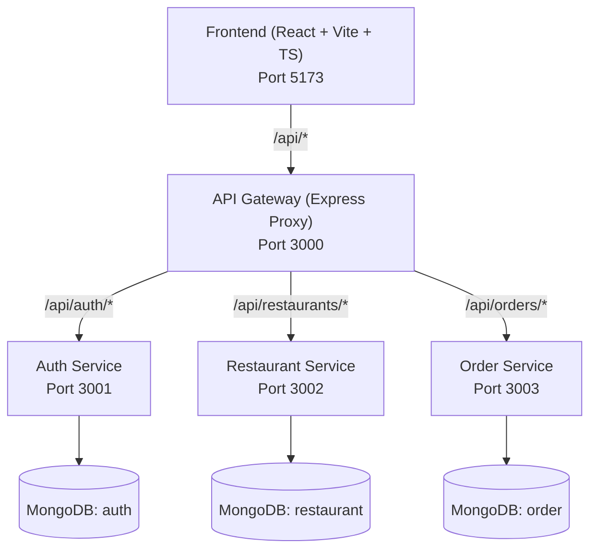

# 🍔 BiteDash - Food Delivery Platform

A full-stack, microservices-based Food Delivery Platform inspired by Zomato and Swiggy. Built with **React + Vite + TypeScript + Tailwind CSS** on the frontend, and a modular **Node.js + Express + TypeScript + MongoDB** microservices backend fronted by an API Gateway.

---

## 🏗️ Architecture Overview



### Services Breakdown

| Service | Port | Description | Database |
| :--- | :--- | :--- | :--- |
| **API Gateway** | `3000` | Central entry point; CORS, route reverse-proxying | - |
| **Auth Service** | `3001` | JWT authentication, user registration, profile & role checks | `food_delivery_auth` |
| **Restaurant Service** | `3002` | Restaurant profiles, cuisines, search, menu items & seed data | `food_delivery_restaurant` |
| **Order Service** | `3003` | Cart checkout, order placement, order status lifecycle & history | `food_delivery_order` |
| **Frontend** | `5173` | React 18 + Vite + Tailwind CSS + Lucide React | - |

---

## 🚀 Getting Started

### 1. Prerequisites
- **Node.js**: v18+ (tested on Node v22)
- **npm**: v9+
- **MongoDB**: Local MongoDB instance (`mongodb://127.0.0.1:27017`) or MongoDB Atlas URI

### 2. Install Dependencies

You can install all dependencies across the workspace:

```bash
# In the root repository directory
npm install
```

Or install individual service dependencies:
```bash
cd services/auth && npm install
cd ../restaurant && npm install
cd ../order && npm install
cd ../gateway && npm install
cd ../../frontend && npm install
```

### 3. Environment Setup

Create `.env` files from `.env.example` templates in each service directory or root:

```bash
# Services
cp services/auth/.env.example services/auth/.env
cp services/restaurant/.env.example services/restaurant/.env
cp services/order/.env.example services/order/.env
cp services/gateway/.env.example services/gateway/.env

# Frontend
cp frontend/.env.example frontend/.env
```

### 4. Running the Application

You can start each service in separate terminal windows:

```bash
# Terminal 1: API Gateway
npm run dev:gateway

# Terminal 2: Auth Service
npm run dev:auth

# Terminal 3: Restaurant Service
npm run dev:restaurant

# Terminal 4: Order Service
npm run dev:order

# Terminal 5: Frontend
npm run dev:frontend
```

Then open [http://localhost:5173](http://localhost:5173) in your browser.

---

## 🍽️ Features & Endpoints

### 🔐 Auth Service (`http://localhost:3001` or `/api/auth`)
- `POST /api/auth/register` - Create customer, restaurant owner, or delivery partner account
- `POST /api/auth/login` - Authenticate user & receive JWT token
- `GET /api/auth/profile` - Get logged-in user profile (`Bearer <token>` required)
- `GET /api/auth/verify` - Validate token status

### 🍕 Restaurant Service (`http://localhost:3002` or `/api/restaurants`)
- `GET /api/restaurants` - List restaurants (supports query filters `?cuisine=...&search=...`)
- `GET /api/restaurants/:id` - Fetch restaurant details with complete menu
- `GET /api/restaurants/seed/demo` - Populate database with 4 curated demo restaurants & 9 menu items
- `POST /api/restaurants` - Create restaurant (owner/admin)
- `POST /api/restaurants/:id/menu` - Add menu item (owner/admin)

### 📦 Order Service (`http://localhost:3003` or `/api/orders`)
- `POST /api/orders` - Place food order from cart items
- `GET /api/orders/user` - Fetch past and active orders for logged-in user
- `GET /api/orders/:id` - View single order details
- `PATCH /api/orders/:id/status` - Update order status (`pending`, `confirmed`, `preparing`, `out_for_delivery`, `delivered`)

### 💻 Frontend UI
- Modern, clean responsive food delivery interface with Tailwind CSS
- Real-time search and cuisine category filters
- Interactive cart drawer with item quantity controls and address inputs
- Simulated checkout with Cash on Delivery / UPI / Card
- Order tracking history page
- Seamless JWT authentication flow with persistent login state
